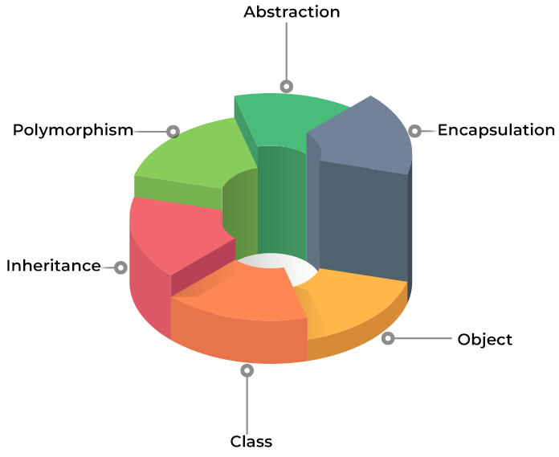

# Semaine 01/16

- [x] C++ est un sur-ensemble (*superset*) de C.
- [x] Il a été inventé par Bjarne Stroustrup en 1979.
- [x] Il a été normalisé par l'ISO en 1998 (ISO/IEC 14882:1998).
- [x] C'est un sur-ensemble, certes, mais il n'est pas entièrement compatible avec C.
- [x] C++ apporte le paradigme objet.
- [x] Les six étages de la programmation orientée objet :
- [x] L'espace de noms `std::` (bibliothèque standard).
- [x] La documentation de référence du C++ : <https://en.cppreference.com/w/>.

## Les six étages de la programmation orientée objet

1. Objet
2. Classe
3. Héritage
4. Polymorphisme
5. Abstraction
6. Encapsulation



## Écrire sur la sortie standard

```cpp
#include <iostream>

int main() {
    std::cout << "Hello World!" << std::endl;
    return 0;
}
```

## Lire depuis l'entrée standard

```cpp
#include <iostream>

int main() {
    int age;
    std::cout << "Quel âge avez-vous ? ";
    std::cin >> age;
    std::cout << "Vous avez " << age << " ans." << std::endl;
    return 0;
}
```

## Régler la précision et la largeur d'affichage

```cpp
#include <iostream>
#include <iomanip>

int main() {
    double pi = 3.14159265358979323846;
    std::cout.precision(5);
    std::cout << "Pi avec 5 chiffres significatifs : " << pi << std::endl;
    std::cout.width(10);
    std::cout << "Pi avec padding : " << pi << std::endl;

    // setprecision + fixed (printf("%.2f", pi))
    std::cout << std::fixed << std::setprecision(2);
    std::cout << "Pi avec 2 chiffres après la virgule : " << pi << std::endl;

    // setw (printf("%10.2f", pi))
    std::cout << std::setw(10) << pi << std::endl;
}
```
