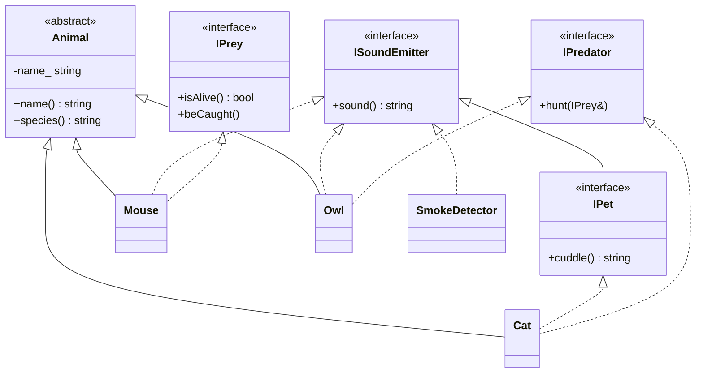

# Introduction

Lors de la séance précédente, vous avez construit une petite hiérarchie de classes : une classe de base abstraite `Animal`, deux classes concrètes `Cat` et `Mouse`, et une collection hétérogène parcourue par polymorphisme. Ce modèle répond à une seule question, celle de savoir *ce qu'est* un objet. Il devient pourtant insuffisant dès que l'on s'intéresse à *ce que sait faire* un objet : chasser, se laisser capturer, émettre un son ou se laisser caresser. Ces capacités traversent la taxonomie sans la respecter, et un détecteur de fumée, qui n'a rien d'un animal, sait lui aussi émettre un son.

Ce travail dirigé vous conduit à remplacer progressivement une modélisation fondée sur l'identité par une modélisation fondée sur les capacités. L'outil qui le permet est l'interface, que C++ n'offre pas sous forme de mot-clé mais qui s'exprime très naturellement par une convention d'écriture.

## Objectifs

Au terme de la séance, vous devez être capable de distinguer une interface d'une classe de base abstraite et de justifier le choix de l'une ou de l'autre. Vous saurez déclarer une interface C++ correcte, c'est-à-dire composée uniquement de méthodes virtuelles pures et d'un destructeur virtuel, sans le moindre attribut. Vous saurez également faire implémenter plusieurs interfaces par une même classe, construire une interface plus riche à partir d'une autre et, surtout, écrire des fonctions qui ne dépendent que de la capacité dont elles ont réellement besoin.

Ce travail suppose acquis les mots-clés `virtual` et `override`, le polymorphisme par pointeur et par référence, ainsi que la manipulation d'une collection de `std::unique_ptr` vers une classe de base.

# Le problème : quand l'héritage devient un carcan

L'héritage public exprime une relation « est un » : un chat *est un* animal. Cette relation est stable et hiérarchique, ce qui en fait un excellent outil pour décrire une identité. Elle se prête en revanche très mal à la description de capacités transverses. Pour s'en convaincre, considérons trois demandes successives formulées sur le code de la séance précédente.

On souhaite d'abord que le chat chasse la souris. La question se pose immédiatement de savoir où déclarer la méthode `hunt()`. On souhaite ensuite organiser un concert réunissant tout ce qui émet un son, y compris un détecteur de fumée : celui-ci doit-il pour autant hériter d'`Animal` ? On remarque enfin que le chat est un animal de compagnie alors que la souris ne l'est pas, et l'on se demande s'il faut intercaler une classe `PetAnimal` entre `Animal` et `Cat`.

La réponse spontanée consiste à tout faire remonter dans la classe de base :

```cpp title="La tentation de la classe de base obèse"
class Animal {
public:
    virtual ~Animal() = default;
    virtual std::string sound() const = 0;
    virtual void hunt(Animal& prey) = 0;    // et la souris ?
    virtual std::string cuddle() const = 0; // et la souris ?
};
```

Cette solution est séduisante par sa simplicité, mais elle a un coût élevé. La souris se trouve contrainte d'implémenter `hunt()` alors qu'elle ne chasse pas ; elle devra soit ne rien faire, soit lever une exception, et dans les deux cas elle trahit le contrat annoncé par sa classe de base, en violation du principe de substitution de Liskov. La classe `Animal` grossit en outre à chaque nouvelle capacité, et chaque ajout impose de recompiler toutes ses sous-classes. Le détecteur de fumée, quant à lui, ne peut participer au concert qu'en devenant un animal, ce qui est absurde. Enfin, la voie des classes intermédiaires (`PetAnimal`, `PredatorAnimal`, puis `PetPredatorAnimal`) conduit à une explosion combinatoire dès que les capacités se croisent.

!!! important "Idée directrice"
    Il faut séparer ce qu'un objet **est**, que l'on exprime par l'héritage d'une classe de base, de ce qu'il **sait faire**, que l'on exprime par des interfaces.

# Interface et composition d'interfaces

## Qu'est-ce qu'une interface en C++ ?

Contrairement à Java ou à C#, le langage C++ ne possède pas de mot-clé `interface`. Une interface y est une convention : une classe abstraite qui ne contient que des méthodes virtuelles pures et un destructeur virtuel, et qui ne déclare aucun attribut.

```cpp title="Une interface minimale"
class ISoundEmitter {
public:
    virtual ~ISoundEmitter() = default;      // indispensable
    virtual std::string sound() const = 0;   // contrat pur
};
```

Trois éléments de cette déclaration méritent d'être compris avec précision. La notation `= 0` rend la méthode virtuelle pure : la classe devient non instanciable et toute classe concrète qui en dérive doit fournir une implémentation. Le destructeur virtuel garantit qu'un objet détruit au travers d'un pointeur `ISoundEmitter*` est détruit en totalité, et non seulement dans sa partie `ISoundEmitter`. L'absence d'attribut et d'implémentation, enfin, est ce qui distingue l'interface d'une classe abstraite ordinaire : une interface décrit un contrat, jamais une manière de le remplir. Le préfixe `I` n'a aucune signification pour le compilateur ; c'est une convention de nommage répandue qui signale l'intention au lecteur.

## Interface ou classe abstraite ?

Les deux notions se ressemblent syntaxiquement mais répondent à des besoins différents (@[tbl:comparaison]). La classe abstraite factorise l'état et le comportement communs à une famille d'objets apparentés ; l'interface réunit des objets éventuellement sans aucun lien de parenté autour d'une capacité commune.

Table: Comparaison entre classe abstraite et interface. {#tbl:comparaison}

| Critère             | Classe abstraite `Animal` | Interface `ISoundEmitter`  |
| ------------------- | ------------------------- | -------------------------- |
| Relation exprimée   | ce que l'objet est        | ce que l'objet sait faire  |
| État (attributs)    | oui (`name_`)             | non                        |
| Code partagé        | oui (`name()`)            | non                        |
| Nombre par classe   | une seule en pratique     | autant que nécessaire      |
| Objets concernés    | une famille apparentée    | des objets sans parenté    |

Cette distinction éclaire la question délicate de l'héritage multiple. Entre classes porteuses d'état, il pose des problèmes réels : attributs dupliqués, implémentations concurrentes, ordre de construction difficile à maîtriser. Entre interfaces, il devient parfaitement sain, puisqu'il n'y a ni état à dupliquer ni implémentation à arbitrer. Une classe peut donc hériter d'une seule identité et d'autant de capacités qu'elle en possède :

```cpp
class Mouse : public Animal, public ISoundEmitter, public IPrey { /* ... */ };
```

## Composer des interfaces

Composer des interfaces consiste à bâtir un contrat plus riche à partir de contrats élémentaires. Un animal de compagnie, par exemple, émet des sons et se laisse caresser. Plutôt que de répéter la méthode `sound()`, on fait hériter la nouvelle interface de l'ancienne :

```cpp title="Composition d'interfaces"
class IPet : public ISoundEmitter {
public:
    virtual std::string cuddle() const = 0;
};
```

La conséquence est majeure : tout `IPet` *est* un `ISoundEmitter`. Une classe qui implémente `IPet` est donc automatiquement acceptée partout où un `ISoundEmitter` est attendu, sans aucune déclaration supplémentaire. Une interface peut aussi se contenter d'agréger plusieurs contrats sans rien leur ajouter, par exemple `class IHunterPet : public IPet, public IPredator {};`.

On prendra garde à ne pas confondre la composition d'interfaces, qui relève de l'héritage entre contrats, avec la composition d'objets, qui désigne une relation « a un » réalisée par un attribut membre. Cette seconde notion, voisine par le nom, ne fait pas l'objet de cette séance.

Le modèle que vous aurez construit à la fin du travail pratique est représenté sous forme de diagramme de classes (@[fig:uml]). On y lit d'un coup d'œil que chaque classe concrète possède une seule identité, éventuellement aucune dans le cas du détecteur de fumée, et un nombre variable de capacités.



Figure: Modèle final : une identité, plusieurs capacités. {#fig:uml}

## Programmer contre une capacité

Le véritable bénéfice des interfaces apparaît dans la signature des fonctions. Chaque fonction exige le contrat minimal dont elle a besoin, et rien de plus :

```cpp
void concert(const std::vector<const ISoundEmitter*>& choir);
void petCorner(const IPet& pet);
```

La fonction `concert` accepte indifféremment un chat, une souris ou un détecteur de fumée ; elle ignore jusqu'à l'existence de la classe `Animal`. C'est précisément ce découplage qui permettra, à la dernière étape, d'ajouter de nouveaux types sans toucher au code existant.

---

# Travail pratique

Vous travaillez en binôme sur le fichier `depart/zoo.cpp`, que vous transformez en quatre étapes. La règle est stricte : **le programme doit compiler et s'exécuter correctement à la fin de chaque étape** avant que vous ne passiez à la suivante. Compilez avec les options d'avertissement complètes, de façon à ce que le compilateur signale la moindre approximation :

```bash
g++ -std=c++17 -Wall -Wextra -pedantic zoo.cpp -o zoo && ./zoo
```

Le code de départ est reproduit ci-dessous. Il ne contient que la hiérarchie taxonomique de la séance précédente.

```cpp title="depart/zoo.cpp"
#include <iostream>
#include <memory>
#include <string>
#include <vector>

class Animal {
public:
    explicit Animal(std::string name) : name_(std::move(name)) {}
    virtual ~Animal() = default;
    const std::string& name() const { return name_; }
    virtual std::string species() const = 0;
private:
    std::string name_;
};

class Cat : public Animal {
public:
    using Animal::Animal;
    std::string species() const override { return "chat"; }
};

class Mouse : public Animal {
public:
    using Animal::Animal;
    std::string species() const override { return "souris"; }
};

int main() {
    std::vector<std::unique_ptr<Animal>> zoo;
    zoo.push_back(std::make_unique<Cat>("Felix"));
    zoo.push_back(std::make_unique<Mouse>("Jerry"));
    zoo.push_back(std::make_unique<Mouse>("Speedy"));

    for (const auto& a : zoo)
        std::cout << a->name() << " est un(e) " << a->species() << '\n';
}
```

## Étape 1 : déclarer trois interfaces (5 min)

Déclarez trois interfaces, en respectant scrupuleusement les règles énoncées dans la section précédente. L'interface `ISoundEmitter` expose la méthode `std::string sound() const`. L'interface `IPrey`, qui décrit une proie, expose `bool isAlive() const` et `void beCaught()`. L'interface `IPredator` expose `void hunt(IPrey& prey)` ; observez que le prédateur ne connaît sa proie qu'au travers de sa capacité à être capturée, et non par son identité.

!!! example "Vérification"
    Ajoutez temporairement la ligne `ISoundEmitter e;` dans `main` et lisez attentivement le message du compilateur. Que vous dit-il, et pourquoi est-ce exactement le comportement souhaité ?

## Étape 2 : implémenter les capacités (5 min)

Faites implémenter les capacités par les classes existantes. La souris est un animal qui émet un son et qui peut être capturée : `Mouse` hérite donc d'`Animal`, d'`ISoundEmitter` et d'`IPrey`, et mémorise son état dans un attribut booléen `alive_`. Une souris capturée se tait et émet désormais « ... ». Le chat est un animal qui émet un son et qui chasse : `Cat` hérite d'`Animal`, d'`ISoundEmitter` et d'`IPredator`. Sa méthode `hunt` capture la proie si celle-ci est encore vivante et affiche un message.

Écrivez ensuite la fonction libre `concert`, qui affiche le son de chacun des émetteurs qu'on lui confie sous la forme d'un vecteur de pointeurs constants vers `ISoundEmitter`. Dans `main`, constituez le chœur à partir de la collection, lancez un premier concert, faites chasser le chat sur chacune des proies, puis lancez un second concert pour constater l'effet de la chasse.

!!! hint "Interroger une capacité"
    La collection contient des `Animal*`. Pour savoir si un animal donné possède une capacité, utilisez `dynamic_cast<IPrey*>(a.get())`, qui renvoie `nullptr` lorsque l'objet n'est pas une proie. Ce transtypage est dit *transversal* : il passe d'une base à une autre base sans lien direct entre elles, en s'appuyant à l'exécution sur le type réel de l'objet.

## Étape 3 : composer une interface (5 min)

Déclarez l'interface `IPet`, qui hérite d'`ISoundEmitter` et ajoute la méthode `std::string cuddle() const`. Modifiez `Cat` pour qu'il implémente `IPet` *à la place* d'`ISoundEmitter`, puis écrivez la fonction `void petCorner(const IPet& pet)`, qui affiche la réaction de l'animal caressé et le son qu'il émet. Appelez-la dans `main` pour chaque animal de compagnie de la collection.

!!! question "À vous de répondre"
    Le chat n'hérite plus directement d'`ISoundEmitter`. Faut-il modifier la fonction `concert` pour qu'il continue d'y participer ? Justifiez votre réponse avant de compiler, puis vérifiez-la.

## Étape 4 : étendre sans rien casser (6 min)

Ajoutez deux nouveaux types. La chouette, `Owl`, est un animal qui émet un son (« Hou hou ») et qui chasse, mais qui n'est pas un animal de compagnie. Le détecteur de fumée, `SmokeDetector`, émet un son (« BIIIP ») mais n'est pas un animal du tout. Insérez une chouette entre les deux souris de la collection, créez un détecteur dans `main` et intégrez ces deux objets au concert ; faites également chasser tous les prédateurs, et non plus seulement le chat.

!!! success "Critère de réussite"
    Aucune ligne des fonctions `concert` et `petCorner`, ni des classes `Cat` et `Mouse`, ne doit avoir été modifiée au cours de cette étape. Si vous avez dû y toucher, revoyez votre conception avant de poursuivre.

À l'issue de cette étape, votre programme doit produire la sortie suivante :

```text
BIIIP Miaou Couic Hou hou Couic
Felix attrape une proie
Felix attrape une proie
BIIIP Miaou ... Hou hou ...
Felix ronronne (Miaou)
```

Remarquez que la chouette ne capture rien : le chat, premier de la collection, a déjà attrapé les deux souris. L'ordre de parcours est ici un détail d'implémentation et non un élément du contrat.

# Synthèse

La leçon de cette séance tient en une phrase : une classe hérite d'une seule identité mais implémente autant de capacités que nécessaire, et le code client ne dépend que des capacités qu'il utilise.

Vous venez, sans les nommer, de mettre en pratique deux des principes SOLID. Le principe de ségrégation des interfaces (*Interface Segregation Principle*) affirme qu'aucun client ne doit dépendre de méthodes qu'il n'utilise pas ; plusieurs petites interfaces ciblées valent donc mieux qu'une interface unique et volumineuse, et c'est exactement ce qui a remplacé la classe `Animal` obèse du début. Le principe ouvert/fermé (*Open/Closed Principle*) demande qu'un module soit ouvert à l'extension mais fermé à la modification ; l'étape 4 l'illustre directement, puisque deux types nouveaux ont été intégrés sans qu'aucune ligne existante ne soit réécrite.

## Erreurs fréquentes

Quelques erreurs reviennent régulièrement lors de ce travail. L'oubli du destructeur virtuel dans une interface est la plus insidieuse : le programme compile, mais la destruction d'un objet au travers d'un pointeur vers l'interface n'appelle pas le destructeur de la classe réelle, ce qui constitue un comportement indéfini. L'oubli du mot-clé `override` laisse passer silencieusement une faute de signature, un simple `const` manquant suffisant à déclarer une nouvelle méthode au lieu de redéfinir celle de l'interface. L'ajout d'un attribut dans une interface la transforme insensiblement en classe de base ordinaire et réintroduit tous les problèmes de l'héritage multiple. Enfin, la multiplication des `dynamic_cast` est souvent le symptôme d'une conception perfectible : l'idéal est qu'une fonction reçoive directement le type d'interface dont elle a besoin, comme le font `concert` et `petCorner`.

## Questions de réflexion

Pour conclure, préparez une réponse argumentée aux trois questions suivantes, qui seront discutées en fin de séance. Pourquoi l'héritage multiple est-il redouté entre classes concrètes, alors qu'il est sans danger entre interfaces ? Faudrait-il une interface `IEater` commune au chat et à la chouette, et qu'apporterait-elle de plus qu'`IPredator` ? Comment Java et C# expriment-ils la même idée, et pourquoi ces langages interdisent-ils l'héritage multiple de classes tout en autorisant l'implémentation de plusieurs interfaces ?

## Pour aller plus loin

Les interfaces étudiées ici reposent sur le polymorphisme dynamique : le choix de la méthode appelée se fait à l'exécution, au prix d'une indirection par la table virtuelle. Les *concepts* introduits par C++20 permettent d'exprimer une capacité au moment de la compilation, sans héritage et sans coût d'appel virtuel. Ce polymorphisme statique, pendant naturel de celui que vous venez de pratiquer, fera l'objet d'une séance ultérieure.
