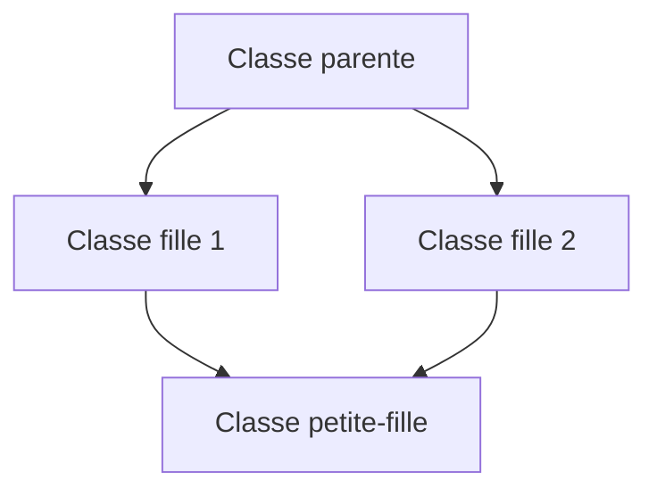

# Semaine 07/16

- [ ] Héritage multiple
  - [x] Problème du diamant
  - [x] Héritage virtuel
  - [x] Composition versus héritage multiple
  - [ ] Mixins
- [ ] Closures/Lambda
  - [ ] Pointeurs de fonction
  - [x] Fonctions anonymes en C++
  - [x] Closures
  - [ ] `std::function`
- [x] Aparté : P =? NP

## Héritage multiple

### Problème du diamant

Le problème du diamant est un problème classique de la programmation orientée objet. Il tire son nom de la forme en losange (*diamond* en anglais) que prend le diagramme de classes lorsqu'une classe hérite de deux classes qui héritent elles-mêmes d'une même classe parente :



En C++, on peut reproduire ce problème assez simplement :

```cpp
#include <iostream>
using namespace std;

struct A { A() { cout << "A\n"; } ~A() { cout << "~A\n"; } };
struct B : public A { B() { cout << "B\n"; } ~B() { cout << "~B\n"; } };
struct C : public A { C() { cout << "C\n"; } ~C() { cout << "~C\n"; } };
struct D : public B, public C { D() { cout << "D\n"; } ~D() { cout << "~D\n"; } };

int main() { D d; }
```

Les constructeurs et destructeurs sont appelés dans l'ordre suivant :

```text
A B A C D
~D ~C ~A ~B ~A
```

On fait plusieurs observations :

1. Le constructeur d'une classe dérivée ne s'exécute qu'une fois ceux de ses classes de base terminés. Ici, D est construit après B et C, qui sont eux-mêmes construits après A. Les destructeurs sont appelés dans l'ordre exactement inverse.
2. Le sous-objet A est créé **deux fois** : une fois pour B et une fois pour C. Un objet D contient donc deux copies de A. Cela pose problème si A détient des ressources (fichiers, sockets, etc.) : deux instances de A tenteront d'y accéder, ce qui peut provoquer des conflits ou des fuites. Cela crée également une ambiguïté : si A possède un membre `x`, l'expression `d.x` est refusée par le compilateur, car il ne peut pas savoir s'il s'agit du `x` hérité via B ou via C. Il faut alors écrire explicitement `d.B::x` ou `d.C::x`.

Concernant le point 2, le compilateur n'a aucun moyen de savoir à l'avance si le partage d'une instance est souhaité ou non. Il construit donc machinalement un sous-objet pour chaque classe de base.

De la même manière qu'avec le polymorphisme dynamique, on peut résoudre ce problème en conservant dans l'objet une information supplémentaire, exploitée à l'exécution. C'est le rôle de l'héritage virtuel.

### Héritage virtuel

Pour « résoudre » le problème du diamant, on déclare A comme **classe de base virtuelle** de B et de C, à l'aide du mot-clé `virtual` dans la liste d'héritage :

```cpp
#include <iostream>
using namespace std;

struct A { A() { cout << "A\n"; } ~A() { cout << "~A\n"; } };
struct B : public virtual A { B() { cout << "B\n"; } ~B() { cout << "~B\n"; } };
struct C : public virtual A { C() { cout << "C\n"; } ~C() { cout << "~C\n"; } };
struct D : public B, public C { D() { cout << "D\n"; } ~D() { cout << "~D\n"; } };

int main() { D d; }
```

Cette fois, A n'est construit et détruit qu'une seule fois :

```text
A B C D
~D ~C ~B ~A
```

Un objet D ne contient plus qu'un seul sous-objet A, partagé par B et C. C'est la classe la plus dérivée (ici D) qui se charge de construire la base virtuelle, avant toutes les autres bases ; les appels au constructeur de A figurant dans les listes d'initialisation de B et de C sont alors ignorés.

Comment B et C retrouvent-ils ce sous-objet A commun ? Sa position dans l'objet n'est plus fixe : elle dépend du type réel de l'objet complet (un B seul ou un B faisant partie d'un D). Le compilateur stocke donc, pour chaque base virtuelle, le décalage à ajouter à l'adresse courante pour atteindre le sous-objet A. GCC et Clang placent ce décalage dans la `vtable` de la classe, tandis que MSVC utilise une table dédiée, la `vbtable` (*virtual base table*). Le principe est le même que pour les méthodes virtuelles : une indirection résolue à l'exécution remplace une adresse connue à la compilation.

Attention à ne pas confondre : en C++, un constructeur ne peut jamais être virtuel. Ce qui est virtuel ici, c'est la **relation d'héritage**, pas les constructeurs ni la classe A elle-même.

### En pratique

Le problème du diamant apparaît parce qu'on utilise l'héritage multiple, que certains langages comme Java ou C# ont d'ailleurs écarté : une classe n'y hérite que d'une seule classe, mais peut implémenter plusieurs interfaces. Python l'autorise toujours (il résout l'ordre des appels grâce à la MRO, *Method Resolution Order*), mais son usage est généralement déconseillé, car il rend le code difficile à comprendre et à maintenir.

En revanche, l'héritage multiple d'interfaces pose peu de problèmes : une interface est une classe abstraite qui ne contient que des méthodes virtuelles pures et aucune donnée membre. Il n'y a donc aucun état susceptible d'être dupliqué.

On retiendra que :

- on évite autant que possible l'héritage multiple d'implémentations, en lui préférant la composition ;
- on s'autorise l'héritage multiple d'interfaces.

### Mixins

Une mixin est une classe qui apporte des fonctionnalités à d'autres classes par héritage, mais qui n'est pas destinée à être instanciée seule. Les mixins servent souvent à ajouter des comportements précis à des classes sans devoir construire une hiérarchie d'héritage complexe.

Prenons un exemple simple en C++ :

```cpp
#include <iostream>

struct Printable {
    void print() const { std::cout << "Printing..." << std::endl; }
};

struct Serializable {
    void serialize() const { std::cout << "Serializing..." << std::endl; }
};

struct MyClass : public Printable, public Serializable {
    void doSomething() const { std::cout << "Doing something..." << std::endl; }
};
```

On pourrait craindre ici un problème du diamant, mais il n'en est rien : `Printable` et `Serializable` n'ont pas de classe de base commune, il n'y a donc aucun losange dans la hiérarchie. De plus, elles ne contiennent aucune donnée membre : elles fournissent simplement des méthodes que `MyClass` peut utiliser.

## Fonctions anonymes et closures

### Pointeurs de fonction

En C pur, il n'existe aucun moyen de créer des fonctions anonymes. Il est néanmoins possible de créer des pointeurs sur des fonctions :

```c
#include <stdio.h>

int add(int a, int b) { return a + b; }

int main(void) {
    int (*f)(int, int) = add; // Pointeur sur la fonction add
    printf("%d\n", f(3, 4));  // Appel de la fonction via le pointeur
}
```

Avec la règle droite-gauche, on décortique la déclaration ainsi :

> `f` est un pointeur sur une fonction qui prend deux entiers en argument et retourne un entier.

`f` est stocké sur 8 octets, sur la pile, et contient l'adresse, dans le segment `.text`, où se trouve le code de la fonction `add`. On peut donc appeler la fonction via le pointeur `f` : le compilateur sait comment gérer les appels de fonction et les conventions d'appel (passage des arguments, adresse de retour, etc.).

Il est donc théoriquement possible, en ne connaissant qu'une seule adresse, de créer en mémoire du code exécutable et de l'appeler comme une fonction. Pour s'amuser, on peut imaginer prendre le code assembleur de notre fonction `add`, le convertir en langage machine, et le stocker manuellement dans une zone de mémoire exécutable.

Notre fonction `add` est très simple : elle ne fait que retourner la somme de deux entiers. Sur Linux, l'ABI System V x86-64 prévoit que les six premiers arguments entiers d'une fonction ne sont pas passés sur la pile mais dans les registres (`rdi`, `rsi`, `rdx`, `rcx`, `r8`, `r9`), ce qui est plus rapide ; la valeur de retour est placée dans `rax`. Le code assembleur de la fonction `add` est donc le suivant :

```asm
add:
    lea eax, [rdi+rsi] ; eax = rdi + rsi
    ret                ; retour de la fonction
```

En assemblant ce code et en récupérant le code machine, on obtient les 4 octets suivants : `8D 04 37 C3`. On peut donc créer un tableau d'octets contenant ce code machine et le convertir en pointeur de fonction pour l'exécuter.

Ce tableau d'apparence innocente est en réalité du code exécutable : en le convertissant en pointeur de fonction, on peut l'appeler comme n'importe quelle autre fonction. Voici un exemple complet en C :

```c
#include <stdio.h>

int main(void) {
    // Code machine de : return a + b;
    unsigned char code[] = {
        0x8D, 0x04, 0x37, // lea eax, [rdi+rsi]
        0xC3              // ret
    };

    int (*f)(int, int) = (int (*)(int, int))code;

    printf("%d\n", f(3, 4));
}
```

Petit bémol cependant : la pile n'est pas exécutable par défaut, pour des raisons évidentes de sécurité. Un attaquant pourrait sinon y injecter du code malveillant (*stack smashing*) et le faire exécuter. Il est donc nécessaire de désactiver cette protection, par exemple avec l'option `-z execstack` à l'édition des liens :

```bash
gcc -z execstack demo.c -o demo
```

La manière propre de procéder consiste à allouer une page mémoire avec `mmap`, à y copier le code, puis à la rendre exécutable (et non inscriptible) avec `mprotect`. C'est ainsi que fonctionnent les compilateurs *just-in-time* (JIT) des machines virtuelles Java ou JavaScript.

### Fonctions anonymes en C++

Une fonction anonyme (ou *lambda*) est une fonction sans nom. Dans sa forme la plus simple, elle fait exactement la même chose que notre pointeur de fonction en C, mais avec une syntaxe propre au C++ :

```cpp
[](){}
```

Pour notre fonction `add`, on peut créer une lambda équivalente :

```cpp
#include <iostream>

int main() {
    int (*add)(int, int) = [](int a, int b) { return a + b; };
    std::cout << add(3, 4) << std::endl;
}
```

Une lambda sans capture est convertible en pointeur de fonction, c'est pourquoi cette affectation est possible. L'élément perturbant ici est le `[]`, que l'on peut lire pour l'instant comme un marqueur qui remplace le nom de la fonction pour signaler qu'elle est anonyme. On y reviendra tout de suite.

### Closures

Parfois, on souhaite déclarer une fonction anonyme tout en lui donnant accès à des variables visibles dans le contexte où elle est définie. C'est précisément le rôle du `[]`, qui s'appelle en réalité la *liste de capture* (*capture list*) : elle permet de capturer des variables locales pour les rendre accessibles dans le corps de la fonction anonyme.

Imaginons que l'on souhaite créer une fonction anonyme qui ajoute à un compteur `x` l'entier `y` reçu en argument, à chaque appel :

```cpp
#include <cassert>

int main() {
    int x = 0;
    auto sum = [&x](int y) { x += y; };
    sum(3);
    sum(4);
    assert(x == 7); // x vaut maintenant 7
}
```

Dans cet exemple, C++ use d'un mécanisme plus complexe qu'un simple pointeur de fonction. Il doit stocker, avec la fonction anonyme, l'adresse de `x`. Le meilleur moyen pour cela est de créer une classe possédant un membre `x` et un opérateur d'appel qui reprend le corps de la fonction anonyme. C'est exactement ce que fait le compilateur :

```cpp
struct __lambda_7 {
    int& x;
    void operator()(int y) const { x += y; }
};

int main() {
    int x = 0;
    __lambda_7 sum{x}; // objet closure sur la pile de main
    sum(3);            // __lambda_7::operator()(&sum, 3)
    sum(4);
}
```

Une *closure* (en français *fermeture*) est donc un objet qui associe une fonction et son environnement, c'est-à-dire les variables capturées. C'est un concept puissant qui permet de créer des fonctions avec état et d'exprimer des comportements complexes de manière élégante.

Il reste deux éléments à aborder pour maîtriser la syntaxe : les modes de capture. On peut capturer une variable par copie ou par référence, et le raccourci `=` ou `&` capture implicitement toutes les variables locales utilisées dans le corps de la lambda. On peut aussi mélanger les deux :

```cpp
int main() {
    int x = 1, y = 2;
    auto f1 = [=]() { return x + y; };     // tout par copie
    auto f2 = [&]() { return x + y; };     // tout par référence
    auto f3 = [x, &y]() { return x + y; }; // capture mixte
}
```

Le choix n'est pas anodin : une variable capturée par copie reste valide même après la fin de la portée où elle a été déclarée (la closure en possède sa propre copie), tandis qu'une variable capturée par référence ne doit jamais être utilisée après la destruction de l'original, sous peine de référence pendante. C'est le piège classique des closures retournées par une fonction ou stockées pour un usage ultérieur.

### `std::function`

Un pointeur de fonction fonctionne très bien pour des fonctions simples sans capture, mais on vient de le voir : une closure doit stocker son environnement, et son appel passe par une méthode (`operator()`) qui reçoit le `this` de l'objet closure en argument implicite. Un pointeur de fonction ordinaire ne peut donc pas contenir une lambda avec capture.

On utilisera alors `std::function`, un *wrapper* plus général : il peut contenir une fonction libre, un pointeur de fonction, une lambda (avec ou sans capture), un objet fonctionnel ou même un pointeur sur une méthode d'instance.

```cpp
#include <cassert>
#include <functional>

int main() {
    int x = 0;
    std::function<void(int)> sum = [&x](int y) { x += y; };
    sum(3);
    sum(4);
    assert(x == 7); // x vaut maintenant 7
}
```

En pratique, `auto` suffit dans la plupart des cas, puisque le compilateur déduit le type exact de la closure. En revanche, dès qu'il faut nommer ce type, par exemple pour déclarer le paramètre d'une fonction ou un membre de classe, on a recours à `std::function` :

```cpp
#include <cassert>
#include <functional>

void apply(std::function<void(int)> f) { f(3); f(4); }

int main() {
    int x = 0;
    apply([&x](int y) { x += y; });
    assert(x == 7); // x vaut maintenant 7
}
```

### Utilisation de closures

Un exemple parlant est la définition d'une classe bouton dans une interface graphique. Un bouton déclenche une action lorsqu'il est cliqué. Mais c'est le moteur graphique, avec sa boucle d'évènements, qui détecte les clics ; de notre côté, nous ne pouvons qu'associer une action au bouton :

```cpp
#include <functional>
#include <iostream>

class Button {
  public:
    void setOnClick(std::function<void()> callback) {
        this->callback = callback;
    }
    void click() { if (callback) callback(); } // appelée par le moteur graphique

  private:
    std::function<void()> callback;
};

int main() {
    Button button;
    int x = 0;
    button.setOnClick([&x]() {
        std::cout << "You clicked the button " << x << " time(s)" << std::endl;
        x++;
    });

    GUI gui; // moteur graphique fictif
    gui.add(button);
    gui.run(); // boucle d'évènements
}
```


## P =? NP

Il existe en informatique un problème ouvert parmi les plus célèbres de la théorie de la complexité : le problème P =? NP. Il s'agit d'une question fondamentale sur la nature des problèmes algorithmiques et sur leur difficulté.

Formulée de manière vulgarisée, la question est la suivante : si la solution d'un problème peut être **vérifiée** rapidement (en temps polynomial, classe NP), ce problème peut-il aussi être **résolu** rapidement (en temps polynomial, classe P) ? Posée par Stephen Cook en 1971 (et indépendamment par Leonid Levin), elle reste ouverte à ce jour et fait partie des sept problèmes du millénaire du Clay Mathematics Institute.

On connaît des milliers de problèmes NP-complets (3-SAT, voyageur de commerce, coloration de graphe, sac à dos…). Un problème est NP-complet s'il appartient à NP et si tout problème de NP peut s'y ramener (par réduction) en temps polynomial : ce sont donc les problèmes « les plus difficiles » de NP. On ne connaît aucun algorithme polynomial pour les résoudre. Conséquence : si un seul d'entre eux pouvait être résolu en temps polynomial, tous les problèmes de NP le pourraient aussi, et l'on aurait P = NP.

Si l'on démontrait P = NP au moyen d'un algorithme réellement efficace en pratique, la quasi-totalité de la cryptographie à clé publique s'effondrerait, car casser une clé revient à résoudre un problème de NP.

L'*Exponential Time Hypothesis* (ETH), proposée par Impagliazzo et Paturi en 1999, va plus loin que P ≠ NP : c'est une **conjecture** (non démontrée) selon laquelle 3-SAT ne peut pas être résolu en temps sous-exponentiel. Autrement dit, il existerait une constante c > 0 telle qu'aucun algorithme ne résout 3-SAT en moins de 2^(c·n) étapes (n étant le nombre de variables). Si l'ETH est vraie, alors P ≠ NP. Elle fixe en quelque sorte un « plancher » exponentiel, et de nombreuses bornes inférieures en algorithmique sont démontrées en la supposant vraie.

Le 26 octobre 2026, OpenAI puis, quelques heures plus tard, Anthropic ont annoncé, chacun de leur côté, qu'un de leurs modèles d'IA avait trouvé un algorithme réfutant l'ETH, avec une preuve vérifiée formellement en Lean. Le résultat est encore en cours d'examen par la communauté (notamment par Impagliazzo, Paturi et Ryan Williams). S'il est confirmé, cela signifie que, pour tout ε > 0, 3-SAT peut être résolu en O(2^(ε·n)) étapes : le plancher exponentiel n'existe pas. En revanche, la complexité reste superpolynomiale : ce résultat ne prouve nullement que P = NP et ne compromet pas directement la cryptographie actuelle. Il s'agit néanmoins d'une avancée théorique majeure, qui ouvre la voie à de nouvelles recherches sur les problèmes NP-complets.
