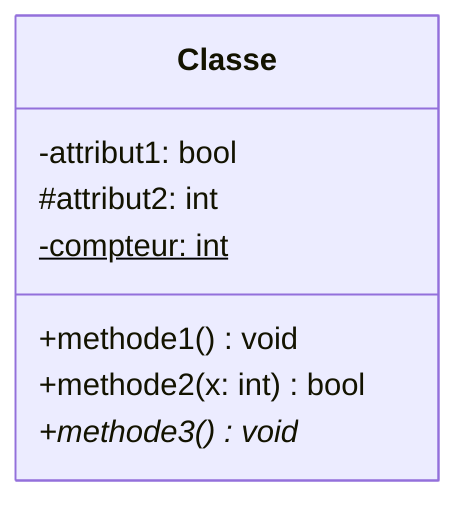
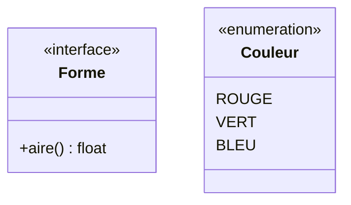
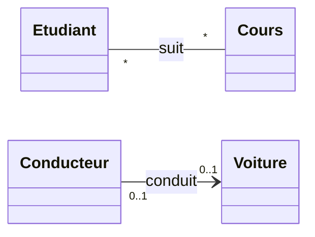
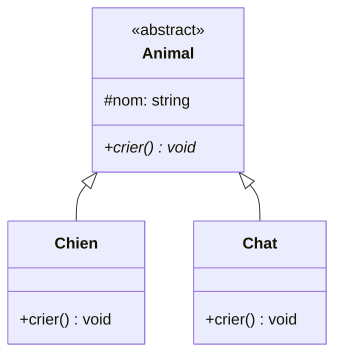
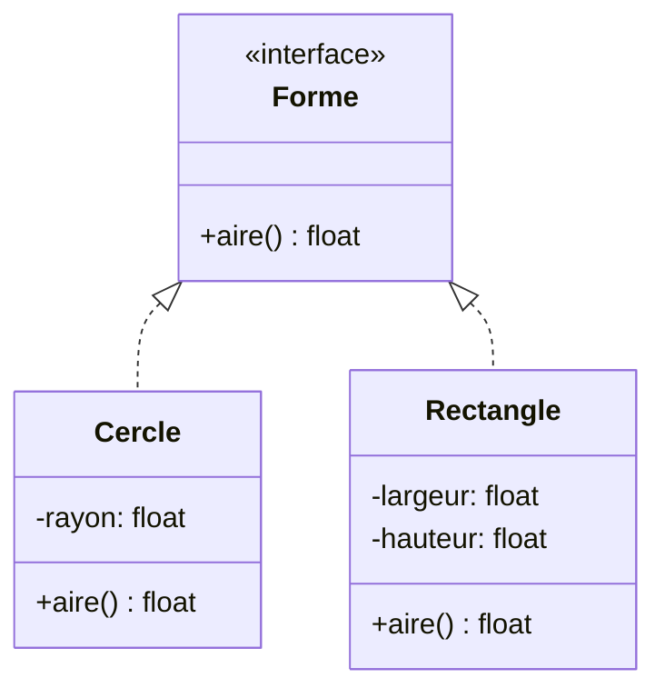
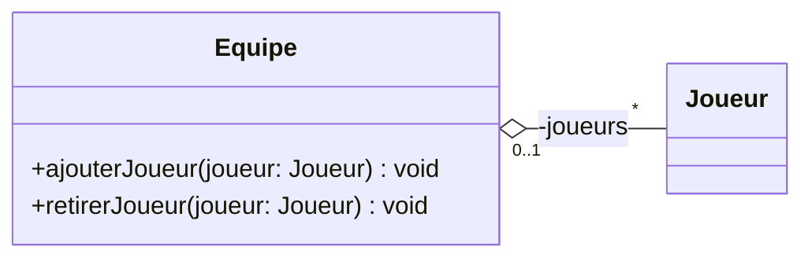
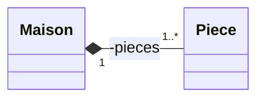
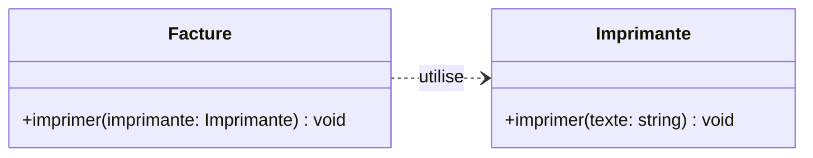
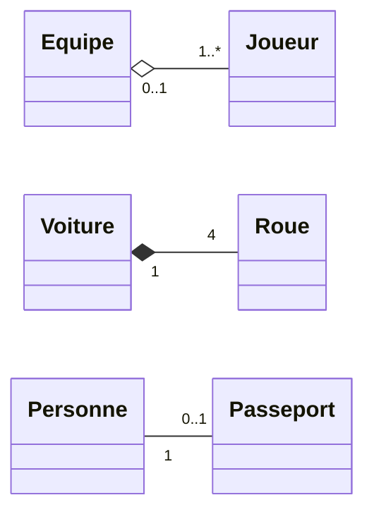
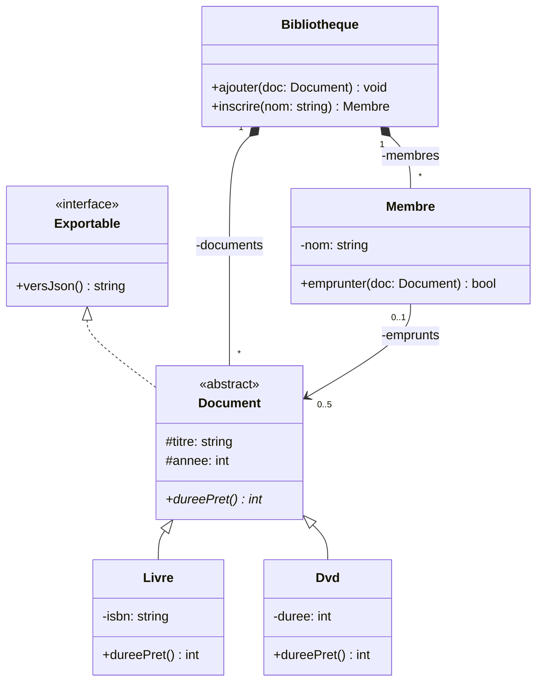

# Semaine 08/16

- [ ] UML
- [ ] Diagrammes de classes
  - [ ] Classe, visibilité, membres statiques et abstraits
  - [ ] Stéréotypes
  - [ ] Relations : association, héritage, réalisation, agrégation, composition, dépendance
  - [ ] Multiplicité
  - [ ] Règles de bonne pratique
  - [ ] Du diagramme au code C++

## UML

UML, pour *Unified Modeling Language*, est un langage de modélisation graphique utilisé pour spécifier, visualiser, construire et documenter les artefacts d'un système logiciel. Il est largement utilisé dans le développement de logiciels orientés objet.

Sa dernière version est UML 2.5.1, publiée en 2017 (la version 2.5 date de 2015). UML est un langage standardisé par l'*Object Management Group* (OMG) dont la spécification est un document PDF de près de 800 pages.

UML définit 14 types de diagrammes, répartis en deux catégories principales :

Les diagrammes structurels
: Ils décrivent la structure statique du système : classes, objets, composants, paquetages, déploiement et relations entre eux.

Les diagrammes comportementaux
: Ils décrivent le comportement dynamique du système : interactions entre les objets et déroulement des processus (diagramme de cas d'utilisation, diagramme d'activité, diagramme de séquence, diagramme d'états-transitions, etc.).

Dans ce cours, seuls les diagrammes de classes et les diagrammes de cas d'utilisation (vus en semaine 7) sont abordés.

## Diagrammes de classes

Un diagramme de classes sert essentiellement à présenter l'architecture d'un système logiciel en programmation orientée objet. Il représente les classes, leurs attributs, leurs méthodes et les relations entre elles. Il ne décrit pas *comment* le programme s'exécute, mais *de quoi* il est fait.

De nombreux éditeurs de diagrammes existent :

- [StarUML](https://staruml.io/)
- [Visual Paradigm](https://www.visual-paradigm.com/)
- [Lucidchart](https://www.lucidchart.com/)
- [Draw.io](https://app.diagrams.net/)

Les trois premiers sont des logiciels commerciaux, mais ils offrent une version d'essai ou une édition gratuite limitée. Draw.io est un logiciel gratuit et open source qui convient très bien aux diagrammes simples.

Il existe aussi des outils *textuels*, où le diagramme est décrit dans un langage puis rendu automatiquement. Ils ont l'avantage de pouvoir être versionnés avec le code (Git) :

- [PlantUML](https://plantuml.com/fr/class-diagram)
- [Mermaid](https://mermaid.js.org/syntax/classDiagram.html), directement interprété par GitHub, GitLab et VS Code dans les fichiers Markdown. C'est l'outil utilisé dans ces notes.

### Classe

Une classe se dessine comme un rectangle divisé en trois compartiments : le nom de la classe, les attributs et les méthodes.

Un préfixe indique la visibilité de l'attribut ou de la méthode :

| Symbole | Visibilité | C++          |
| ------- | ---------- | ------------ |
| `+`     | publique   | `public`     |
| `-`     | privée     | `private`    |
| `#`     | protégée   | `protected`  |
| `~`     | paquetage  | (pas d'équivalent direct) |

Le type d'un attribut, d'un paramètre ou la valeur de retour d'une méthode est indiqué après le nom, séparé par un `:`. On privilégie les noms de types génériques (`int`, `bool`, `string`, `float`) plutôt que des types spécifiques à un langage de programmation (`std::vector<std::shared_ptr<T>>`).

```text
+------------------------------+
|           Classe             |
+------------------------------+
| - attribut1: bool            |
| # attribut2: int             |
| - compteur: int = 0          |  <- valeur par défaut
+------------------------------+
| + methode1(): void           |
| + methode2(x: int): bool     |
+------------------------------+
```

Quelques conventions supplémentaires :

- Un membre **statique** (`static` en C++) est **souligné**.
- Une classe ou une méthode **abstraite** (virtuelle pure en C++) s'écrit en *italique*. Comme l'italique est difficile à lire (et impossible à dessiner à la main), on peut aussi utiliser la mention `{abstract}`.
- Les compartiments des attributs et des méthodes peuvent être omis lorsqu'ils ne sont pas pertinents pour le propos du diagramme.

Avec Mermaid, le même exemple s'écrit (`$` pour statique, `*` pour abstrait) :



### Stéréotypes

Le stéréotype, du grec *stereos* (« solide ») et *typos* (« empreinte »), est un mécanisme d'extension de la sémantique d'un élément UML. Il permet de créer de nouvelles catégories d'éléments en les spécialisant. Les stéréotypes sont représentés par des mots-clés placés entre guillemets français `« »` (souvent écrits `<< >>` faute de mieux) au-dessus du nom de l'élément.

Les stéréotypes les plus courants sont :

- `<<interface>>` : la classe est une interface (en C++, une classe ne contenant que des méthodes virtuelles pures).
- `<<abstract>>` : la classe est abstraite. Ce n'est pas un stéréotype officiel d'UML (qui utilise l'italique ou `{abstract}`), mais il est très répandu, notamment dans Mermaid.
- `<<enumeration>>` : la classe est une énumération (`enum class` en C++), ses valeurs sont listées dans le compartiment des attributs.

```text
+-------------------+
|  <<stereotype>>   |
|      Classe       |
+-------------------+
|                   |
```



### Relations

Les relations sont représentées par des lignes reliant les classes entre elles. Selon le type de relation, la ligne est pleine ou pointillée, et son extrémité porte une flèche, un triangle ou un losange :

| Relation    | Notation                                  | Mermaid  | Se lit             |
| ----------- | ----------------------------------------- | -------- | ------------------ |
| Association | ligne pleine (flèche optionnelle)         | `-->`    | « connaît un »     |
| Héritage    | ligne pleine, triangle vide               | `<\|--`  | « est un »         |
| Réalisation | ligne pointillée, triangle vide           | `..\|>`  | « implémente »     |
| Agrégation  | ligne pleine, losange vide côté tout      | `o--`    | « a des »          |
| Composition | ligne pleine, losange plein côté tout     | `*--`    | « est composé de » |
| Dépendance  | ligne pointillée, flèche ouverte          | `..>`    | « utilise »        |

#### Association

Une association est une relation structurelle entre deux classes qui indique que les objets de l'une sont connectés aux objets de l'autre de manière durable (typiquement, l'un détient un pointeur ou une référence vers l'autre). Elle est représentée par une ligne simple entre les classes. Une flèche peut indiquer le sens de navigation : qui connaît qui. Les associations peuvent porter un nom, des rôles et des multiplicités.

Exemple : un étudiant suit des cours, et un cours est suivi par des étudiants. Un conducteur conduit une voiture (la voiture ne connaît pas son conducteur, d'où la flèche).



```cpp
class Voiture { /* ... */ };

class Conducteur {
    Voiture* voiture = nullptr; // association navigable de Conducteur vers Voiture
public:
    void monter(Voiture& v) { voiture = &v; }
    void descendre() { voiture = nullptr; }
};
```

#### Héritage (ou généralisation)

L'héritage est une relation entre une classe parente (superclasse) et une classe enfant (sous-classe). La sous-classe hérite des attributs et des méthodes de la superclasse. Il est représenté par une ligne pleine terminée par un triangle vide pointant vers la superclasse.

On la prononce « est un » ou « est une » pour indiquer que la sous-classe est un type spécifique de la superclasse : un chien **est un** animal, une voiture **est un** véhicule.



```cpp
class Animal {
protected:
    std::string nom;
public:
    virtual ~Animal() = default;
    virtual void crier() const = 0;
};

class Chien : public Animal {
public:
    void crier() const override { std::cout << "Wouf\n"; }
};
```

#### Réalisation (ou implémentation)

La réalisation est une relation entre une interface et une classe qui l'implémente. Elle est représentée par une ligne pointillée terminée par un triangle vide pointant vers l'interface.

On la prononce « implémente » pour indiquer que la classe fournit une implémentation concrète du contrat défini par l'interface : un `Cercle` **implémente** l'interface `Forme`, une `Voiture` **implémente** l'interface `Conduisible`.



En C++, il n'y a pas de mot-clé `interface` : on utilise une classe abstraite ne contenant que des méthodes virtuelles pures, et on en hérite publiquement.

#### Agrégation

L'agrégation est une relation « partie-tout » entre deux classes, où une classe représente un tout et l'autre une partie. Elle est représentée par une ligne avec un losange vide du côté de la classe qui représente le tout. Il s'agit le plus souvent d'une collection d'objets détenus **par référence** (pointeur) par le tout.

L'agrégation est une relation faible : la partie peut exister indépendamment du tout, et peut même être partagée entre plusieurs touts. Par exemple, une classe `Equipe` peut avoir une agrégation avec la classe `Joueur`, car un joueur existe indépendamment d'une équipe : si l'équipe est dissoute, les joueurs continuent d'exister.

Les éléments sont généralement passés au constructeur, ou ajoutés à la collection par des méthodes du tout. Pour la classe `Equipe`, on pourrait avoir `ajouterJoueur(joueur: Joueur)` et `retirerJoueur(joueur: Joueur)`.



```cpp
class Equipe {
    std::vector<Joueur*> joueurs; // l'équipe ne possède pas les joueurs
public:
    void ajouterJoueur(Joueur& j) { joueurs.push_back(&j); }
    void retirerJoueur(Joueur& j) { std::erase(joueurs, &j); }
};
```

#### Composition

La composition est une relation « partie-tout » plus forte que l'agrégation. Elle est représentée par une ligne avec un losange plein du côté de la classe qui représente le tout. Il s'agit le plus souvent d'objets détenus **par valeur** (ou par `std::unique_ptr`) par le tout.

Les parties sont créées et détruites avec le tout, et une partie n'appartient qu'à un seul tout à la fois. Par exemple, une classe `Maison` peut avoir une composition avec la classe `Piece`, car une pièce n'existe pas indépendamment d'une maison. Le constructeur de `Maison` crée les pièces et son destructeur les détruit (en C++, c'est automatique si les pièces sont des membres par valeur).



```cpp
class Maison {
    std::vector<Piece> pieces; // les pièces vivent et meurent avec la maison
public:
    Maison(int n) : pieces(n) {}
};
```

#### Dépendance

La dépendance est la relation la plus faible : une classe en *utilise* une autre de manière ponctuelle, sans la conserver comme attribut. Typiquement, l'autre classe apparaît comme paramètre, variable locale ou type de retour d'une méthode. Une modification de la classe utilisée peut nécessiter une modification de la classe dépendante. Elle est représentée par une flèche pointillée allant de la classe dépendante vers la classe dont elle dépend.

Exemple : une `Facture` peut s'imprimer sur une `Imprimante` passée en paramètre, mais elle ne la garde pas.



```cpp
class Facture {
public:
    void imprimer(Imprimante& imprimante) const {
        imprimante.imprimer("Facture n° 42"); // utilisée, mais pas mémorisée
    }
};
```

### Multiplicité

La multiplicité indique combien d'instances d'une classe peuvent être associées à une instance d'une autre classe. Elle est indiquée par des nombres ou des intervalles placés près de l'extrémité de la ligne, **du côté de la classe dont on compte les instances**.

| Multiplicité | Signification          |
| ------------ | ---------------------- |
| `1`          | exactement un          |
| `0..1`       | zéro ou un (optionnel) |
| `*` ou `0..*`| zéro ou plusieurs      |
| `1..*`       | au moins un            |
| `2..4`       | entre deux et quatre   |

Par exemple, entre une classe `Equipe` et une classe `Joueur`, une multiplicité `1..*` du côté de `Joueur` indique qu'une équipe a au moins un joueur, mais peut en avoir plusieurs. Une multiplicité `0..1` du côté d'`Equipe` indique qu'un joueur appartient à au plus une équipe.



On lit chaque extrémité depuis l'autre classe : « une voiture a **4** roues », « une roue appartient à **1** voiture ».

### Règles

**On ne duplique pas l'information.** Une relation vers une autre classe n'apparaît pas comme attribut, mais uniquement comme une relation. Par exemple, la `Equipe` ci-dessus ne liste pas `-joueurs: Joueur[*]` dans ses attributs : c'est la ligne d'agrégation qui porte cette information. Le nom du rôle (le nom de l'attribut en C++) et sa visibilité sont placés à l'extrémité de la ligne, **du côté de la classe référencée**, à côté de la multiplicité.

```text
+--------+ 0..1             -joueurs  +--------+
| Equipe |<>-------------------------| Joueur |
+--------+                      1..*  +--------+
```

**On organise le diagramme pour qu'il se lise naturellement.** On privilégie les généralisations et les réalisations de haut en bas, avec les classes les plus générales en haut et les plus spécifiques en bas. De la même manière, on privilégie les agrégations et les compositions de gauche à droite, le tout à gauche et les parties à droite. Ces règles ne sont pas absolues, mais elles rendent les diagrammes plus lisibles.

**On évite les croisements de lignes** autant que possible, quitte à réorganiser les classes.

**On adapte le niveau de détail au public.** Un diagramme d'architecture n'a pas besoin de lister les accesseurs (`getX`, `setX`) ni les constructeurs. Un diagramme qui ne tient pas sur une page est le signe qu'il faut le découper.

### Exemple complet

Une bibliothèque gère des documents (livres et DVD) et des membres. Chaque membre peut emprunter jusqu'à cinq documents. Les documents sont exportables en JSON.



On y retrouve :

- une **réalisation** : tout `Document` est `Exportable` ;
- deux **héritages** : un `Livre` et un `Dvd` *sont des* `Document` ;
- deux **compositions** : la bibliothèque possède ses documents et ses membres, qui disparaissent avec elle ;
- une **association** : un membre *connaît* les documents qu'il a empruntés, sans les posséder (au plus cinq, et un document est emprunté par au plus un membre).
