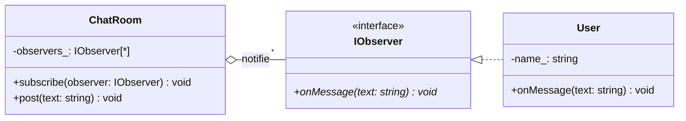

# Semaine 09/16

- [x] Patrons de conception
  - [x] Gang of Four
  - [x] Observateur
  - [x] Singleton
- [x] Pointeurs intelligents : `std::shared_ptr` et `std::weak_ptr`
- [x] Opérateur de déplacement

## Patrons de conception

Les patrons de conception (*design patterns*) sont apparus dans le monde du logiciel au début des années 1990. L'idée vient à l'origine de l'architecte Christopher Alexander qui, dans les années 1970, avait catalogué des solutions récurrentes pour la construction de bâtiments et de villes. Des développeurs ont remarqué qu'en programmation orientée objet aussi, on retombe sans cesse sur les mêmes problèmes et qu'on finit par les résoudre de la même manière.

Un patron de conception est donc une solution réutilisable à un problème courant. Ce n'est pas un bout de code que l'on copie-colle, ni une bibliothèque : c'est une **façon d'organiser des classes** et leurs relations, qu'on adapte ensuite à son propre programme. Ils permettent de structurer le code de manière efficace et maintenable.

Leur intérêt principal est double :

- On ne réinvente pas la roue : la solution a déjà été éprouvée par d'autres, avec ses avantages et ses inconvénients connus.
- On partage un vocabulaire. Dire à un collègue « ici j'utilise un observateur » suffit à lui faire comprendre toute l'architecture, sans avoir à la dessiner.

## Gang of Four

Le livre *Design Patterns: Elements of Reusable Object-Oriented Software*, publié en 1994 par quatre auteurs (Erich Gamma, Richard Helm, Ralph Johnson et John Vlissides, surnommés le *Gang of Four* ou GoF), est un grand classique du développement logiciel. C'est la référence incontournable sur les 23 patrons de conception qu'il décrit.

Mais il faut distinguer la qualité du contenu du plaisir de lecture : le livre est dense, abstrait et ses exemples (en C++ et Smalltalk) ont vieilli. Il reste intéressant parce que :

- Il apprend à résoudre des problèmes récurrents d'architecture logicielle.
- Il permet de mieux comprendre la programmation orientée objet.
- Il donne un vocabulaire commun aux développeurs.
- Ses concepts restent pertinents aujourd'hui.

En 2026, on préférera s'informer sur les patrons de conception via un LLM ou depuis l'excellent site <https://refactoring.guru/fr/design-patterns>, qui présente chaque patron avec des illustrations, un diagramme de classes et des exemples de code dans plusieurs langages, dont le C++.

## Observateur

L'observateur (*observer*) répond à la question suivante : comment un objet peut-il **prévenir d'autres objets** qu'il s'est passé quelque chose, sans les connaître précisément ?

L'exemple vu en classe est un salon de discussion (`ChatRoom`). Lorsqu'un message est posté, tous les utilisateurs présents doivent le recevoir. On a donc deux rôles :

Le sujet (ou observable)
: L'objet qui change d'état ou produit des événements. Ici, le `ChatRoom`. Il tient une liste de ses observateurs, permet de s'y abonner (`subscribe`) et les notifie (`post`).

L'observateur
: L'objet qui veut être prévenu. Ici, un `User`. Il implémente une interface commune (`IObserver`) dont la méthode `onMessage` est appelée par le sujet.



Le point clé est que le `ChatRoom` ne connaît **que l'interface** `IObserver`. Il ne sait pas qu'il parle à des `User`. Demain, on pourrait ajouter un `Logger` qui archive les messages ou un `Bot` qui y répond : il suffirait qu'ils héritent de `IObserver`, sans modifier une seule ligne du `ChatRoom`. On retrouve ici le polymorphisme dynamique vu en semaine 6 : `onMessage` est virtuelle pure, et c'est la version de la classe concrète qui est appelée.

On retrouve ce patron partout : les interfaces graphiques (un bouton notifie ceux qui écoutent son clic), les tableurs (une cellule notifie les cellules qui dépendent d'elle), les systèmes d'abonnement, les notifications d'un téléphone…

### Qui possède les observateurs ?

La vraie difficulté de l'observateur en C++ n'est pas le patron lui-même, mais la **durée de vie des objets**. Le salon garde une liste d'utilisateurs, mais il n'en est pas propriétaire : un utilisateur peut quitter le programme (être détruit) sans penser à se désabonner.

Si le `ChatRoom` stockait de simples pointeurs `IObserver*`, il garderait l'adresse d'un objet détruit et, au prochain message, appellerait `onMessage` sur une zone mémoire libérée. C'est un *use-after-free* : un comportement indéfini, qui peut planter, afficher n'importe quoi, ou pire, sembler fonctionner.

La solution retenue dans [observer.cpp](observer.cpp) est de stocker des `std::weak_ptr` (voir plus bas). Dans `main`, Bob est créé dans un bloc `{ }` et détruit à la fin de ce bloc, sans jamais se désabonner :

```text
Alice received: hello
Bob received: hello
Bob left
Alice received: anyone here?
Alice left
```

Le second message n'est reçu que par Alice : le salon a détecté que Bob n'existait plus et l'a simplement oublié.

## Singleton

Le singleton est un patron de conception qui garantit qu'une classe n'a **qu'une seule instance** et fournit un point d'accès global à cette instance. Il est souvent utilisé pour gérer des ressources partagées, comme une connexion à une base de données ou un gestionnaire de configuration.

En C++, on l'obtient en combinant plusieurs mécanismes déjà vus en cours :

```cpp
struct Singleton {
    Singleton(const Singleton&) = delete;            // pas de copie
    Singleton& operator=(const Singleton&) = delete; // pas d'affectation

    static Singleton& get_instance() {
        static Singleton instance; // créée au premier appel, une seule fois
        return instance;
    }

private:
    Singleton() = default; // personne d'autre ne peut construire
};
```

1. Le constructeur est **privé** : on ne peut pas écrire `Singleton s;` en dehors de la classe.
2. Le constructeur de copie et l'opérateur d'affectation sont **supprimés** (`= delete`) : on ne peut pas dupliquer l'instance existante.
3. La méthode **statique** `get_instance` est le seul point d'accès. Elle contient une variable locale `static` : elle est construite la première fois que la fonction est appelée, puis conservée jusqu'à la fin du programme. Tous les appels suivants renvoient une référence vers ce même objet.

Le `main` de [singleton.cpp](singleton.cpp) ne compile volontairement pas, et chaque erreur illustre une protection :

```cpp
auto u = Singleton::get_instance(); // erreur : `auto` déduit `Singleton`, donc une copie
                                    // or le constructeur de copie est supprimé
Singleton v;                        // erreur : le constructeur est privé
auto& w = Singleton::get_instance(); // OK : on obtient une référence vers l'unique instance
```

Le premier cas est un piège classique : `auto` ne déduit jamais une référence, il faut écrire `auto&` explicitement.

On voit souvent le singleton comme un « anti-pattern », car c'est au fond une variable globale déguisée. Il introduit des dépendances cachées (n'importe quelle fonction peut y accéder sans que cela apparaisse dans ses paramètres) et rend le code difficile à tester (impossible de remplacer l'instance par une fausse pour un test). Il est donc recommandé de l'utiliser avec parcimonie et de préférer d'autres solutions comme l'injection de dépendances, c'est-à-dire passer explicitement l'objet partagé à ceux qui en ont besoin. On le trouve néanmoins très fréquemment dans les cas suivants :

- Gestion de ressources partagées (ex. : connexion à une base de données)
- Gestion de configuration (ex. : paramètres de l'application)
- Journalisation (ex. : gestionnaire de *logs*)

## Pointeurs intelligents

En semaine 6, nous avons vu `std::unique_ptr` : un pointeur qui est l'**unique** propriétaire de l'objet pointé et qui le libère automatiquement lorsqu'il est détruit (c'est le RAII appliqué à la mémoire). Il ne peut pas être copié, puisqu'il n'y aurait alors plus un seul propriétaire.

Mais parfois, un objet doit être partagé entre plusieurs propriétaires, et on ne sait pas à l'avance lequel disparaîtra en dernier. C'est le rôle de `std::shared_ptr`.

### `std::shared_ptr`

Un *shared pointer* est un pointeur intelligent qui gère la durée de vie d'un objet partagé. Il utilise un **compteur de références** pour suivre combien de `shared_ptr` pointent vers le même objet. Chaque copie incrémente le compteur, chaque destruction le décrémente. Lorsque le dernier `shared_ptr` est détruit, le compteur tombe à zéro et l'objet est automatiquement libéré.

On le crée avec `std::make_shared`, qui alloue l'objet et transmet ses arguments au constructeur :

```cpp
#include <iostream>
#include <memory>

struct Foo {
    ~Foo() { std::cout << "Foo détruit\n"; }
};

int main() {
    auto a = std::make_shared<Foo>();
    std::cout << a.use_count() << '\n';     // 1
    {
        auto b = a;                         // copie : a et b partagent le même Foo
        std::cout << a.use_count() << '\n'; // 2
    }                                       // b est détruit, le compteur repasse à 1
    std::cout << a.use_count() << '\n';     // 1
}                                           // a est détruit, compteur à 0 : "Foo détruit"
```

Dans [observer.cpp](observer.cpp), Alice et Bob sont créés avec `std::make_shared<User>(...)`. C'est la variable `alice` (ou `bob`) dans `main` qui est propriétaire de l'utilisateur.

### `std::weak_ptr`

Le *weak pointer* est un pointeur intelligent qui **ne participe pas** au comptage de références. Il observe un objet géré par des `shared_ptr` sans le maintenir en vie. Il est utilisé pour éviter les cycles de références (deux objets qui se possèdent mutuellement par `shared_ptr` ne seraient jamais libérés) et, plus généralement, pour référencer un objet dont on n'est pas propriétaire.

C'est exactement la situation de l'observateur : le `ChatRoom` ne détient pas la propriété des utilisateurs, il les observe. Ainsi, si un utilisateur est détruit, le `weak_ptr` ne bloque pas sa destruction. Et contrairement à un pointeur nu, le `weak_ptr` **sait** si l'objet existe encore :

- `expired()` renvoie `true` si l'objet a été détruit.
- `lock()` tente de convertir le `weak_ptr` en `shared_ptr`. Si l'objet existe encore, on obtient un `shared_ptr` valide qui le garde en vie le temps de l'utiliser. Sinon, on obtient un `shared_ptr` vide (équivalent à `nullptr`).

On ne peut pas accéder directement à l'objet via un `weak_ptr` : il est nécessaire, au moment de contacter l'utilisateur, de le convertir en `shared_ptr` avec `lock()`. C'est ce que fait la méthode `post` du salon :

```cpp
void post(const std::string& text) {
    // Retire de la liste les observateurs qui n'existent plus.
    std::erase_if(observers_, [](const auto& weak) { return weak.expired(); });

    for (const auto& weak : observers_)
        if (auto observer = weak.lock())  // shared_ptr valide ?
            observer->onMessage(text);    // oui : on peut l'utiliser sans risque
}
```

La condition `if (auto observer = weak.lock())` déclare une variable et la teste en même temps : un `shared_ptr` vide est évalué à `false`. On retrouve aussi une lambda (semaine 7) passée à `std::erase_if` pour décider quels éléments supprimer.

## Opérateur de déplacement

Le déplacement est apparu avec C++11. Il complète la liste des fonctions membres spéciales vue en semaine 5 avec un **constructeur de déplacement** et un **opérateur d'affectation par déplacement**. On le reconnaît à la double esperluette `&&` dans la signature, et on le déclenche avec `std::move`.

Copier et déplacer sont deux opérations différentes :

La copie
: Crée un nouvel objet identique à l'original. L'original est intact. Si l'objet possède des ressources (un grand tableau, une chaîne, un fichier), il faut les dupliquer, ce qui peut être coûteux.

Le déplacement
: **Transfère** les ressources de l'original vers le nouvel objet, sans les dupliquer. L'original est « vidé » : il reste dans un état valide (on peut le détruire ou lui affecter une nouvelle valeur), mais on ne doit plus compter sur son contenu.

C'est comme un déménagement : on peut acheter des meubles identiques pour le nouvel appartement (copie), ou simplement transporter les siens (déplacement). Le second est bien plus rapide, mais l'ancien appartement se retrouve vide.

L'exemple vu en classe ([move.cpp](move.cpp)) montre comment le compilateur choisit le constructeur :

```cpp
#include <utility> // std::move

struct C {
    C() {}                   // constructeur par défaut
    C(const C& other) {}     // constructeur par copie
    C(C&& other) {}          // constructeur par déplacement
};

int main() {
    C u;
    C v(u);             // u est une variable nommée : copie
    C w(std::move(u));  // std::move(u) : déplacement
}
```

`std::move` ne déplace rien par lui-même, malgré son nom. Il indique simplement au compilateur : « je n'ai plus besoin de cet objet, tu peux lui prendre ses ressources ». Le compilateur choisit alors la version `&&` du constructeur. Après un `std::move(u)`, on ne devrait plus utiliser `u`, sauf pour le détruire ou lui affecter une nouvelle valeur.

On a déjà croisé le déplacement sans le nommer :

- Dans le constructeur de `User` de [observer.cpp](observer.cpp), `name_(std::move(name))` : le paramètre `name` est une copie locale dont on n'a plus besoin, on transfère donc son contenu dans l'attribut au lieu de le copier une seconde fois.
- Un `std::unique_ptr` ne peut pas être copié (il n'y aurait plus un unique propriétaire), mais il peut être **déplacé** : `auto up2 = std::move(up);` transfère la propriété, et `up` devient vide.

Le déplacement permet donc d'éviter des copies inutiles et améliore les performances, en particulier pour les objets qui gèrent de grosses ressources.
